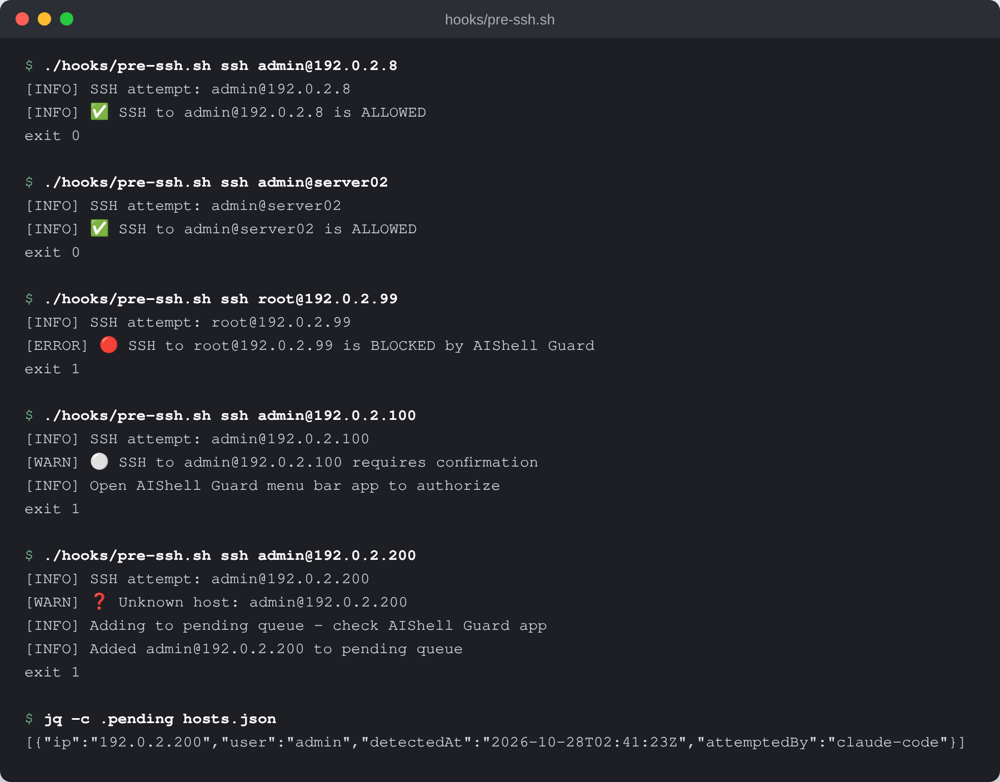

# AIShell Guard

A macOS menu bar app and pre-SSH hook that decide which servers your AI coding assistant may SSH into.

[](LICENSE)
[](https://swift.org/)
[](.github/workflows/build.yml)



## What it is

AIShell Guard has two parts that share one JSON state file:

- **`hooks/pre-ssh.sh`**, a hook your AI tool runs before an SSH command. It looks the target up in the state file and exits `0` (allow) or `1` (stop). Unknown hosts are stopped and added to a pending queue.
- **The menu bar app** (SwiftUI, `SSHGuard/`), where you mark each host **allowed**, **ask** or **blocked**, organise hosts into groups, and approve or reject pending hosts.

## Why it exists

AI coding assistants such as Claude Code, Cursor and Windsurf can run `ssh` to deploy code or inspect servers. That is useful, but it leaves two poor choices: trust every SSH command the assistant writes, or confirm each one by hand. AIShell Guard adds a third: you decide ahead of time which hosts the assistant may reach, and anything new waits for you in the menu bar.

## How it works



The AI tool calls `hooks/pre-ssh.sh` with the SSH command it wants to run. The hook parses `user@host`, finds the state file (the `AISHELLGUARD_STATE_FILE` variable, the path set in the app, `~/.config/pai/infrastructure/ssh-permissions.json` if it exists, or `~/.config/aishellguard/hosts.json`), and matches the target by IP or hostname. Allowed hosts pass with exit `0`; hosts marked ask or blocked are stopped with exit `1`; unknown hosts are stopped and written to the `pending` list. The menu bar app's `StateManager` reads and writes the same file, so a change you make in the popover applies to the very next SSH attempt. The app can also sign the host list with `HMACSigner` so tampering is detectable.

## Features

- **Three host states**: allowed (green), ask (grey), blocked (red), changed with one click in the menu bar.
- **Unknown host queue**: first-time SSH targets are stopped and listed for review instead of silently allowed.
- **Host groups** with drag-and-drop ordering, notes and tags.
- **Search** across hosts by name, IP or tag.
- **Optional HMAC signature** over the host list.
- **Local only**: one JSON file, no account, no cloud sync, no third-party Swift dependencies.

## Quick start

Requirements: macOS 13 or later, Swift 5.9+ (Xcode 15+), and [jq](https://jqlang.github.io/jq/) for the hook (`brew install jq`).

```bash
git clone https://github.com/rodaddy/aishellguard.git
cd aishellguard
swift build -c release      # build the menu bar app
./scripts/install.sh        # build, install the app and the hook
```

Try the hook on its own against a throwaway state file:

```bash
export AISHELLGUARD_STATE_FILE="$PWD/demo-hosts.json"
echo '{"version":"1.0","machine":"demo","hosts":[{"id":"web-01","hostname":"web-01","ip":"192.0.2.8","user":"admin","state":"allowed"}],"pending":[]}' > "$AISHELLGUARD_STATE_FILE"
./hooks/pre-ssh.sh ssh admin@192.0.2.8; echo "exit $?"     # allowed, exit 0
./hooks/pre-ssh.sh ssh admin@192.0.2.200; echo "exit $?"   # unknown, exit 1, added to pending
```

## Configuration

### State File

Located at: `~/.config/aishellguard/hosts.json`

```json
{
  "version": "1.0",
  "machine": "my-mac",
  "hosts": [
    {
      "id": "server-01",
      "hostname": "server-01",
      "ip": "192.0.2.10",
      "user": "admin",
      "state": "allowed",
      "note": "Primary server",
      "tags": ["production"]
    }
  ],
  "pending": []
}
```

### Host States

| State | Icon | Behavior |
|-------|------|----------|
| `allowed` | 🟢 | SSH proceeds without prompts |
| `ask` | ⚪ | SSH blocked, requires manual confirmation |
| `blocked` | 🔴 | SSH explicitly denied |

### Preferences

- **State File Location** - Customizable path
- **Menu Bar Icon** - Multiple styles available
- **HMAC Signing** - Optional state file integrity verification

## Hook Integration

AIShell Guard works by intercepting SSH commands before they execute.

### For Claude Code

Add to your Claude Code hooks configuration:

```bash
# Create hooks directory
mkdir -p ~/.config/aishellguard/hooks

# Copy hook script
cp /path/to/aishellguard/hooks/pre-ssh.sh ~/.config/aishellguard/hooks/

# Make executable
chmod +x ~/.config/aishellguard/hooks/pre-ssh.sh
```

Then configure Claude Code to use the hook for SSH commands. The hook takes the SSH command as arguments (`pre-ssh.sh ssh user@host`), while Claude Code's `PreToolUse` hooks receive the tool call as JSON on stdin, so a short wrapper must pass the command through.

### For Cursor / Windsurf

Similar hook integration - configure your tool to run `pre-ssh.sh` before SSH commands.

### Testing the Hook

These run against the example state that `scripts/install.sh` copies from `schemas/example-state.json`. `./scripts/test-hook.sh` runs the same checks against a throwaway state file.

```bash
# Test allowed host
./hooks/pre-ssh.sh ssh admin@192.0.2.10
# Expected: ✅ SSH allowed (exit 0)

# Test unknown host
./hooks/pre-ssh.sh ssh admin@192.0.2.99
# Expected: ❓ Unknown host, added to pending (exit 1)

# Test blocked host
./hooks/pre-ssh.sh ssh root@192.0.2.60
# Expected: 🔴 SSH blocked (exit 1)
```

### Hook Logs

Check `~/.config/aishellguard/hook.log` for connection attempts.

## Troubleshooting

### Hook Not Running

```bash
# Check hook is executable
ls -la ~/.config/aishellguard/hooks/pre-ssh.sh

# Check jq is installed
which jq || brew install jq
```

### All SSH Blocked

```bash
# Verify state file exists and is valid JSON
cat ~/.config/aishellguard/hosts.json | jq .

# Check app is running
pgrep -l AIShellGuard
```

### State File Errors

```bash
# Reset to empty state
echo '{"version":"1.0","machine":"mac","hosts":[],"pending":[]}' > ~/.config/aishellguard/hosts.json
```

### Emergency Bypass

If the hook is broken and you need SSH immediately:

```bash
# Temporarily remove hook
mv ~/.config/aishellguard/hooks/pre-ssh.sh ~/.config/aishellguard/hooks/pre-ssh.sh.disabled

# After emergency, restore
mv ~/.config/aishellguard/hooks/pre-ssh.sh.disabled ~/.config/aishellguard/hooks/pre-ssh.sh
```

## Development

### Requirements

- macOS 13.0+
- Xcode 15.0+ or Swift 5.9+
- jq (for hook testing)

### Building

```bash
# Debug build
swift build

# Release build
swift build -c release

# Run tests
swift test
```

### Project Structure

```
aishellguard/
├── Package.swift           # Swift package manifest
├── SSHGuard/              # Main app source (will rename to AIShellGuard)
│   ├── SSHGuardApp.swift  # App entry point
│   ├── StateManager.swift # State file management
│   ├── MenuBarManager.swift
│   ├── Models/
│   └── Views/
├── hooks/
│   └── pre-ssh.sh         # Claude Code hook
├── schemas/
│   └── ssh-permissions.schema.json
└── scripts/
    └── install.sh
```

## Contributing

See [CONTRIBUTING.md](CONTRIBUTING.md).

## How it was built

The hook, state file schema and menu bar app were built in one day,
2026-02-01, with an AI pair programmer, and the design decisions were written
down as they were made (`docs/STATE-FILE-DESIGN.md`,
`docs/MENUBAR-POPOVER-REFACTOR.md`). The order of work, the bugs found on the
first day and why the menu became a popover are in
[docs/BUILD-STORY.md](docs/BUILD-STORY.md).

## Project status

Experimental. The hook and the menu bar app build and run (`swift build`); there is no signed release build yet, so install from source. The Swift sources still live in `SSHGuard/` from the project's earlier name.

## Credits

Built with SwiftUI and the Swift Package Manager. The hook uses [jq](https://jqlang.github.io/jq/).

## Licence

[MIT](LICENSE). Copyright (c) 2026 Rico Rojas.

## Author

Rico Rojas, https://rico-rojas.com
